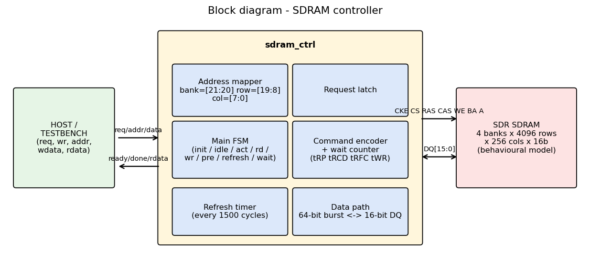
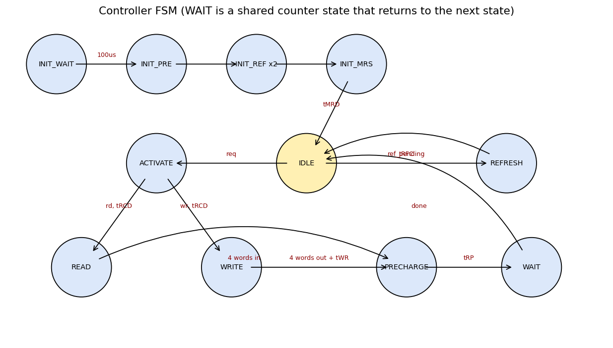
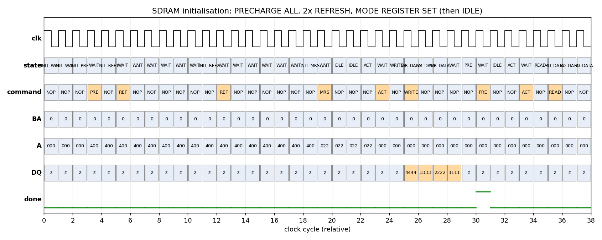
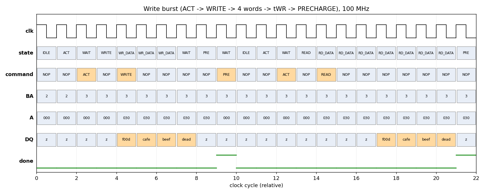
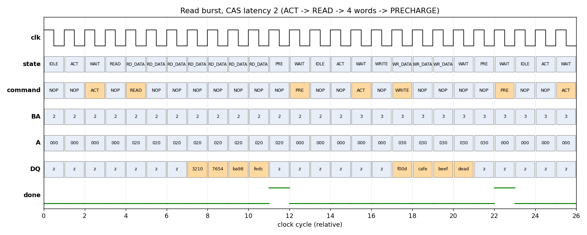
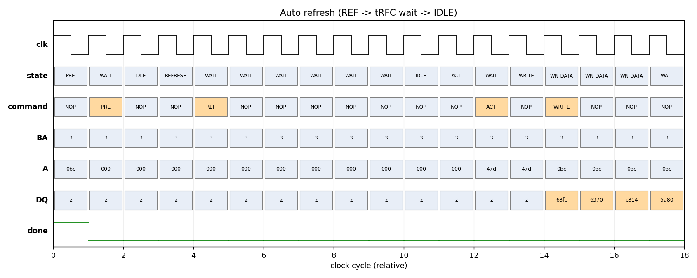

# Assignment 2 - High-Speed SDRAM Memory Controller

Simple SDR SDRAM controller in Verilog, 100 MHz, 16-bit bus, CAS latency 2, burst length 4.

## Verification status
Verified with Icarus Verilog 12.0 on Ubuntu 26.04 (WSL2): `make sim` and `make stress` both pass
(0 failed checks, 0 protocol errors). `pymodel/` is a cycle-accurate Python copy of the design used for the
diagrams; its performance numbers match the Verilog results.

## Files
| path | what |
|---|---|
| rtl/sdram_ctrl.v | the controller |
| sim/sdram_model.v | behavioural SDRAM + protocol checker (tRP, tRCD, tRFC, tWR, refresh deadline, init) |
| sim/tb_sdram_ctrl.v | testbench (7 phases) |
| sim/Makefile | `make sim`, `make stress`, `make waves` |
| pymodel/sdram_pymodel.py | Python model, run `python3 sdram_pymodel.py [REF_INTERVAL]` |
| results/ | waves.vcd (open in gtkwave), sim_log*.txt |
| docs/ | block / FSM / waveform pictures |

## Design decisions
* **Close-page policy**: every access is ACT -> RD/WR -> PRE. Simple and safe (refresh never finds an open bank),
  but slow because the row is closed after every burst. Open-page would be faster for same-row traffic.
* **Fixed burst 4**: mode register = 0x022 (BL4, sequential, CL2). Host moves 64 bits per request, which avoids a
  streaming handshake on the host side.
* **Address map**: `addr[21:20]` bank, `[19:8]` row, `[7:0]` column. Bank in the top bits = simple, but
  low bits as bank would allow bank interleaving.
* **S_WAIT state**: one shared down-counter for all timing delays (tRP, tRCD, tRFC, tMRD, tWR), so timing values are parameters.
* **Refresh** has priority over host requests in IDLE; timer interval 1500 cycles (15 us < 15.6 us).
* Registered outputs, async active-low reset, DQ tri-stated except during writes.

## Block diagram

## FSM

States: Idle, Activate, Read, Write, Precharge, Refresh, Wait (+ init states and RD_DATA / WR_DATA data-beat states).

## Timing (from simulation)
| param | cycles | | param | cycles |
|---|---|---|---|---|
| tRP | 2 | | tRFC | 7 |
| tRCD | 2 | | tMRD | 2 |
| tWR | 2 | | CL | 2 |

## Verification plan
| test | what | result |
|---|---|---|
| Functional | write/read each bank, re-read | pass |
| Randomized | 300 random write/read on 64-address pool, scoreboard compare | pass |
| Stress | 1000 back-to-back ops + bank/row thrash; also run with refresh every 100 cycles | pass |
| Corner | addr 0, max addr, row 0xFFF, col 0xFC, all-0/all-1, walking 1, overwrite same address | pass |
| Reset | reset in the middle of a write and a read (row open), controller re-inits, old data intact | pass |
| Protocol checker | SDRAM model errors on any timing/command violation | 0 errors |

Python-model totals: 1138 data checks passed, 0 failed, 0 protocol errors (both REF_INTERVAL=1500 and 100).

## Performance analysis (Python model, 200 writes + 200 reads, same row, REF_INTERVAL=1500)
| metric | value |
|---|---|
| Total cycles | 4623 for 400 bursts (1600 words) |
| Write latency (accept -> done) | 9 cycles |
| Read latency (accept -> done) | 11 cycles |
| Throughput | 346 words / 1000 cycles = **~69 MB/s** at 100 MHz (peak 200 MB/s) |
| Bus utilization | **34.6 %** (32.3 % with refresh every 100 cycles) |
| Memory efficiency | ~34.6 % of peak bandwidth (same number as utilization here, since the bus only carries payload data) |
| Refresh overhead | 3 refreshes x ~9 cycles = ~0.6 % |

Why only ~35 %: close-page costs ~11.5 cycles per 4-cycle burst (ACT, tRCD, command, data, PRE, tRP, IDLE hand-off).
Possible improvements: open-page policy, auto-precharge, issuing PRE earlier (CL-1 before last data), overlapping
ACT of the next bank (bank interleaving), pipelined host interface.

## Known limitations
* Not tested with a real vendor SDRAM model or on hardware.
* Close-page only, BL4 only, no byte masking (DQM = 0), no host streaming.
* Verilog not yet compiled by a real tool (see top).
